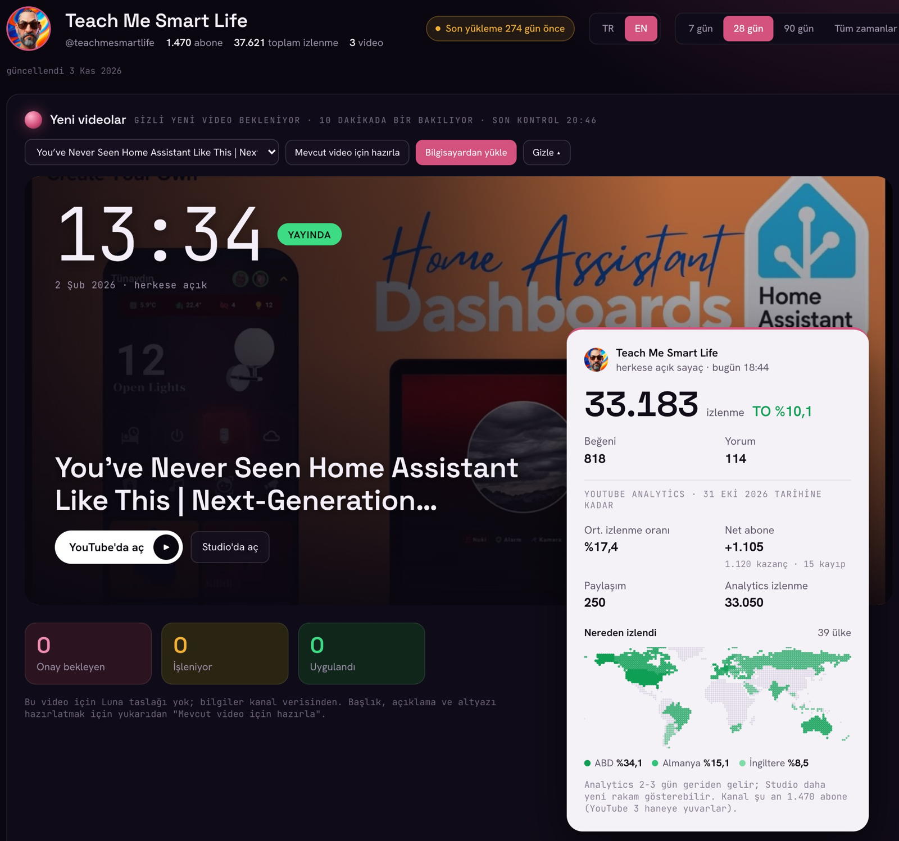

Türkçe YouTube kanalımdaki videoların eşlik sayfası. Videolarda "açıklamada vereceğim" dediğim rehberler, yönergeler ve örnekler burada. Her video için bir klasör var; bir rehberi kendi yapay zekânıza (Claude, ChatGPT vb.) verip "bu rehberle bana yardım et" demeniz yeterli.

Yapay zekâyı gerçek hayatta, evde ve işte en verimli şekilde nasıl kullanabileceğinizi anlatıyorum. Kanalı takip etmek isterseniz:

## YouTube

[Berkan Sezer](https://www.youtube.com/@benberkansezer)

***
# YouTube API + yapay zekâ: kanalını yapay zekâya bağla



*Videoda kurulan kanal sayfası, İngilizce kanalım Teach Me Smart Life üzerinde.*

YouTube'un üç API'si (Data, Analytics, Reporting) ile kanalınızı bir yapay zekâ ajanına bağlamanın adım adım rehberi. Kurulumu yapay zekânıza yaptırabilirsiniz; giriş ve izin her zaman sizde.

**Nasıl kullanılır:**
1. Kurulum rehberini açın: [rehber dosyası (README.md)](videolar/youtube-api-yapay-zeka/README.md)
2. Dosyanın **tamamını** yapay zekânıza verin. En kolayı: [ham hâlini açın](https://raw.githubusercontent.com/berkansezer77/turkish-youtube-content/main/videolar/youtube-api-yapay-zeka/README.md), hepsini seçip kopyalayın ve sohbete yapıştırın. İsterseniz dosyayı indirip sohbete ekleyin.
3. Sohbete şunu yazın: *"Bu rehberle YouTube kanalımı yapay zekâya bağlamama yardım et."*

Yapay zekâ sizi adım adım yürütür. Videoda gösterilen sayfaya benzer bir sayfa isterseniz, klasördeki uydurma verili `ornek-sayfa.html` dosyasını da verin.

[Klasörü aç: rehber, örnek sayfa ve görseller](videolar/youtube-api-yapay-zeka)

***

## Klasör yapısı

```
videolar/
└── youtube-api-yapay-zeka/
    ├── README.md          rehber (yapay zekânıza verin)
    ├── ornek-sayfa.html   örnek kanal sayfası, bütün veriler uydurma
    └── images/            ekran görüntüleri
```

Her yeni video `videolar/` altında kendi klasörünü alır ve bu sayfaya görseliyle eklenir.

## Güvenlik

Bu depoda hazır kod, gizli anahtar ya da kişisel veri yok; rehberler gereken her şeyi tarif eder, kodu sizin yapay zekânız yazar. Rehberlerin oluşturduğu `client_secret*.json` ve `token*.json` dosyalarını kendi kopyanıza koymayın; `.gitignore` bunları zaten dışarıda bırakır.
