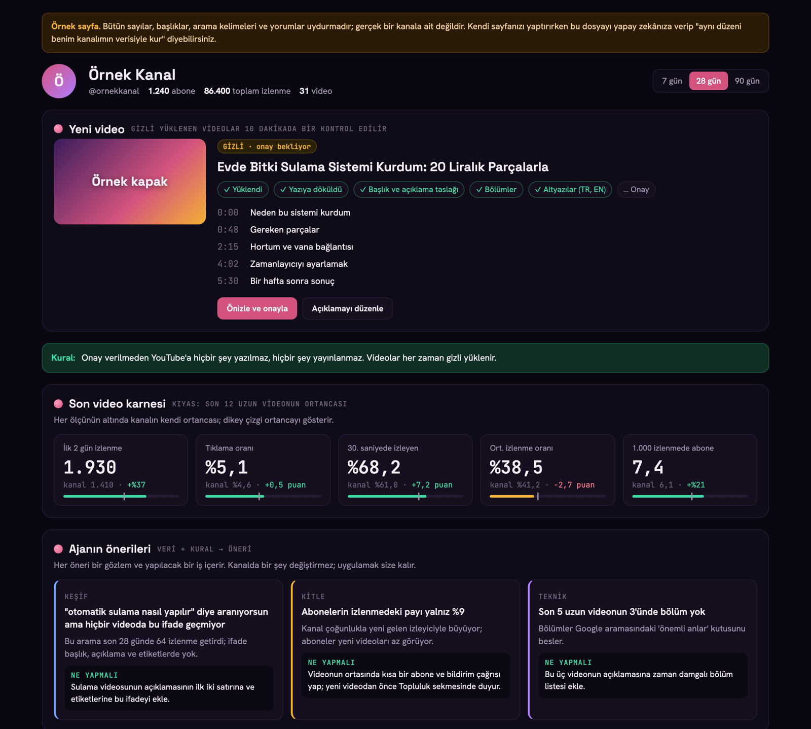

Türkçe YouTube kanalımdaki videoların eşlik sayfası. Videolarda "açıklamada vereceğim" dediğim rehberler, yönergeler ve örnekler burada. Her video için bir klasör var; bir rehberi kendi yapay zekânıza (Claude, ChatGPT vb.) verip "bu rehberle bana yardım et" demeniz yeterli.

Yapay zekâyı gerçek hayatta, evde ve işte en verimli şekilde nasıl kullanabileceğinizi anlatıyorum. Kanalı takip etmek isterseniz:

## YouTube

[Berkan Sezer](https://www.youtube.com/@benberkansezer)

***
# YouTube API + yapay zekâ: kanalını yapay zekâya bağla



YouTube'un üç API'si (Data, Analytics, Reporting) ile kanalınızı bir yapay zekâ ajanına bağlamanın adım adım rehberi. Kurulumu yapay zekânıza yaptırabilirsiniz; giriş ve izin her zaman sizde. Yanında, videoda gösterilen kanal sayfasının uydurma verili bir örneği var.

[Rehber ve örnek sayfa](videolar/youtube-api-yapay-zeka)

***

## Klasör yapısı

```
videolar/
└── youtube-api-yapay-zeka/
    ├── README.md          rehber (yapay zekânıza verin)
    ├── ornek-sayfa.html   örnek kanal sayfası, bütün veriler uydurma
    └── images/            ekran görüntüleri
```

Her yeni video `videolar/` altında kendi klasörünü alır ve bu sayfaya görseliyle eklenir.

## Güvenlik

Bu depoda hazır kod, gizli anahtar ya da kişisel veri yok; rehberler gereken her şeyi tarif eder, kodu sizin yapay zekânız yazar. Rehberlerin oluşturduğu `client_secret*.json` ve `token*.json` dosyalarını kendi kopyanıza koymayın; `.gitignore` bunları zaten dışarıda bırakır.
