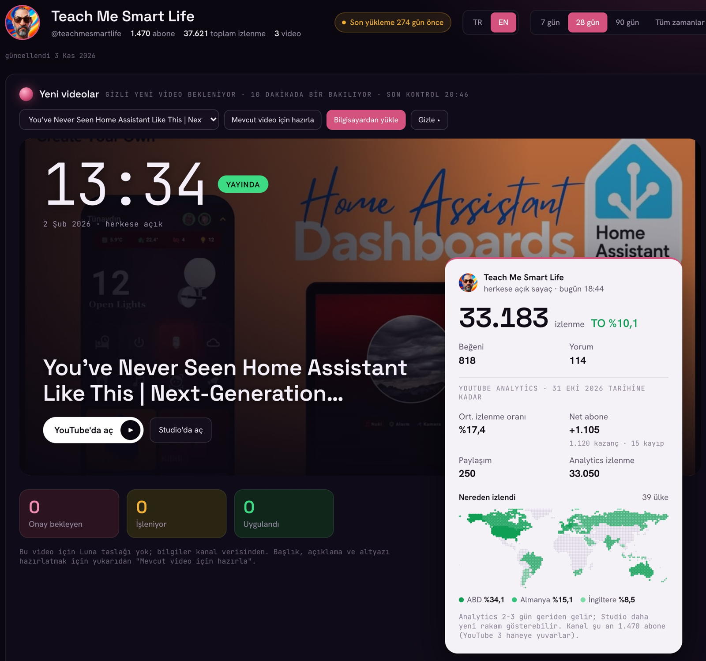
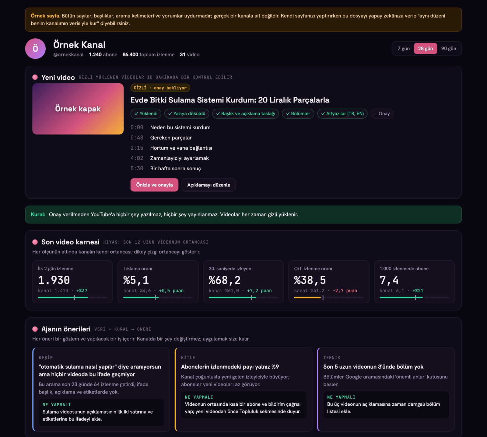
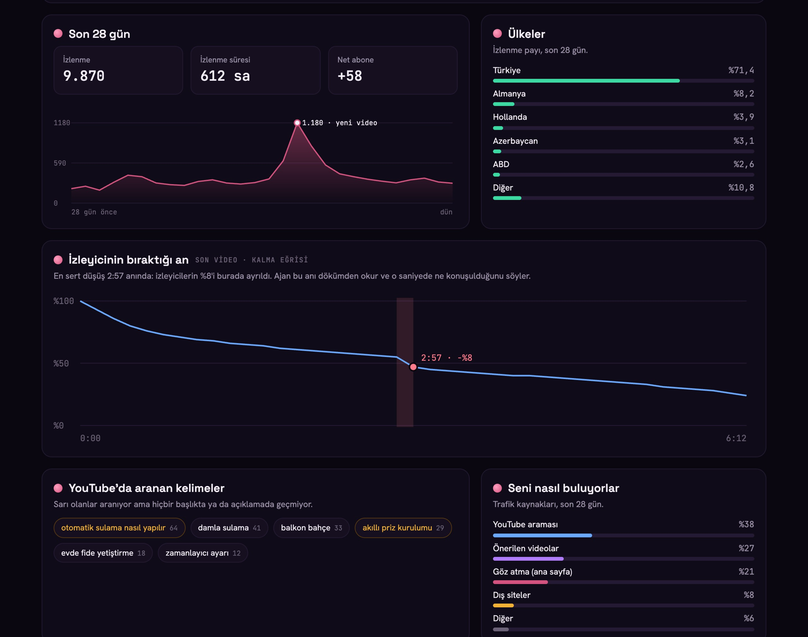

# YouTube kanalını yapay zekâya bağlama rehberi



Bu dosya, "YouTube API + yapay zekâ" videosunun eşlik dosyasıdır.

> **Bu dosyayı kendi yapay zekânıza verin.**
> 1. [Bu dosyanın ham hâlini açın](https://raw.githubusercontent.com/berkansezer77/turkish-youtube-content/main/videolar/youtube-api-yapay-zeka/README.md), hepsini seçip kopyalayın (ya da dosyayı indirin).
> 2. Claude, ChatGPT gibi yapay zekânızın sohbetine yapıştırın (ya da dosyayı ekleyin).
> 3. Şunu yazın: *"Bu rehberle YouTube kanalımı yapay zekâya bağlamama yardım et."*
>
> Yapay zekâ sizi adım adım yürütür. Kendiniz okumak isterseniz rehber aşağıda.

> **Yapay zekâya not:** Kullanıcıyı aşağıdaki adımlarla, sırayla yürüt. Her adımın sonundaki "Bitti mi?" satırını kullanıcıya sor, doğrulanmadan bir sonraki adıma geçme. Şifre girme, izin ekranını kullanıcı adına onaylama, gizli dosyaların içeriğini isteme. Bu depoda hazır kod yok: Adım 5 ve son kontrol için gereken küçük programları, aşağıdaki tariflere birebir uyarak **sen yaz**, kullanıcıya ne yaptığını kısaca anlat ve onun bilgisayarında çalıştır (ya da çalıştırmasını anlat). Kullanıcı kod bilmiyor olabilir; her komutu tek tek, nereye yazacağıyla birlikte ver.

---

## 0) Bu dosya ne yapar, ne yapmaz

- **Yapar:** Kendi YouTube kanalınızı, Google'ın resmi API'leri üzerinden bir yapay zekâ ajanına bağlamanız için gereken her adımı anlatır. Sonunda elinizde kanalınızı okuyabilen ve (onayınızla) yönetebilen bir bağlantı olur.
- **Yapmaz:** Sizin yerinize giriş yapmaz. Google hesabına giriş ve izin ekranındaki onay **her zaman sizde**.
- **Gizli dosyalar:** Adım 4'te indireceğiniz JSON dosyası ve Adım 5'te oluşacak `token.json`, kanalınızın anahtarıdır. GitHub'a koymayın, sohbete yapıştırmayın, kimseyle paylaşmayın.
- **Onay kuralı:** Video yükleme, başlık değiştirme, yorum yazma gibi kanalda bir şey değiştiren her işlem sizin onayınızla yapılmalı. Yüklenen videolar her zaman **gizli** yüklenir, yayına siz alırsınız.
- **Ücret:** Üç API de ücretsizdir; yalnız günlük bir kullanım kotası vardır ve kişisel kullanım için fazlasıyla yeterlidir.

## 1) Hangi araçla ne yapılır

| Araç | Ne yapar |
|---|---|
| Düz bir sohbet (ör. Claude, ChatGPT) | Bu dosyayı okur, adımları size tek tek anlatır. Tıklamaları siz yaparsınız. |
| Tarayıcıyı kullanabilen bir araç (ör. Claude in Chrome) | Google Cloud ekranlarında sizin yerinize tıklar ve formları doldurur. Giriş ve izin yine sizde. |
| Bilgisayarda çalışan bir ajan (ör. Claude Code) | Adım 5 ve son kontroldeki küçük programları bu rehberdeki tariften kendisi yazar ve çalıştırır; sonra isterseniz analiz sayfasını ve yükleme ajanını kurar (bölüm 10). |

Not: Düz bir sohbet, kurulum bitse bile kanal verilerinizi kendiliğinden göremez. Verileri okumak için bağlantıyı kullanan bir programın bilgisayarınızda çalışması gerekir. En kolay yol bir ajan (Claude Code gibi) kullanmak: programı yazar ve çalıştırır. Düz sohbet kullanıyorsanız, sohbet programı yazar, siz Terminal'e yapıştırıp çalıştırırsınız.

## 2) Başlamadan önce

- Kanalınızın bağlı olduğu **Google hesabı** (kanal bir marka hesabındaysa, o kanalı yöneten hesap).
- Bir bilgisayar ve tarayıcı.
- **Python 3** (Adım 5 ve son kontrolde yapay zekânın yazacağı küçük programlar için). macOS'ta Terminal'de `python3 --version` yazınca bir sürüm görüyorsanız hazırsınız. Programlar yalnız Python'un kendi kütüphaneleriyle yazılabilir, ek paket gerekmez.
- Adım 6 için bir **ana sayfa** ve **gizlilik politikası** adresi. Kendi siteniz yoksa ücretsiz bir sayfa (ör. GitHub Pages) yeterli. Gizlilik politikasında uygulamanın yalnız kendi kanalınızın verisini okuduğunu ve kimseyle paylaşmadığını yazmanız yeterli.
- Google Cloud Console arayüzü İngilizce adlarla anlatılıyor; düğme adları zamanla küçük değişiklikler gösterebilir.

---

## Adım 1: Google Cloud projesi aç

1. [console.cloud.google.com](https://console.cloud.google.com) adresine kanalın Google hesabıyla girin.
2. Üstteki proje seçiciye tıklayın, açılan pencerede **New project**'i seçin.
3. Projeye bir isim verin (ör. `YouTube Agent`). Organizasyonu olduğu gibi bırakın, **Create**'e basın.
4. Proje hazır olunca bildirimden **Select project** ile yeni projeyi seçin.

**Bitti mi?** Üstteki proje seçicide yeni projenizin adı yazıyor olmalı.

## Adım 2: Üç API'yi aç

**APIs & Services → Library**'ye girin, "YouTube" diye aratın ve şu üçünü tek tek açın (**Enable**):

| API | Ne verir |
|---|---|
| YouTube Data API v3 | Videolar, yükleme, başlık, açıklama, altyazı, yorumlar |
| YouTube Analytics API | İzlenme, izlenme süresi, izleyicinin bıraktığı an, kitle |
| YouTube Reporting API | Tıklama oranı (CTR) gibi toplu raporlar; bir kez kurulunca Google her gün rapor dosyası hazırlar |

**Bitti mi?** **APIs & Services → Enabled APIs & services** listesinde bu üç API görünmeli.

## Adım 3: OAuth izin ekranını kur

Bu, ajan kanalınıza erişmek istediğinde Google'ın size göstereceği izin sayfasıdır.

1. **APIs & Services → OAuth consent screen → Get started**.
2. Uygulama adı (ör. `YouTube Agent`) ve destek e-postası olarak kendi adresiniz. **Next**.
3. Kitle olarak **External**'ı seçin (kişisel hesapta Internal seçilemez). **Next**.
4. İletişim e-postasını ekleyin, Google'ın kullanıcı verisi politikasını kabul edin, **Create**.
5. **Data Access → Add or remove scopes**. En alttaki kutuya şu iki izni yapıştırın, tabloya ekleyin, **Update** ve kaydedin:
   ```
   https://www.googleapis.com/auth/youtube.force-ssl
   https://www.googleapis.com/auth/yt-analytics.readonly
   ```
   Birincisi kanalı yönetmek (yükleme, başlık, yorum), ikincisi istatistikleri okumak içindir. Reporting API de ikinci izni kullanır.
6. **Audience → Add users**: bağlayacağınız kanalın e-posta adresini test kullanıcısı olarak ekleyin, kaydedin.

**Bitti mi?** Data Access'te iki izin, Audience'ta test kullanıcısı olarak kendi e-postanız görünmeli.

## Adım 4: Masaüstü OAuth istemcisi oluştur, JSON'u indir

1. **Clients → Create client**.
2. Uygulama türü: **Desktop app**. Bir isim verin, **Create**.
3. Açılan pencereden **JSON dosyasını hemen indirin.** Google gizli anahtarı yalnız bir kez gösterir.
4. Dosyayı bilgisayarınızda güvenli bir klasöre koyun (ör. `client_secret.json` adıyla).

**Bitti mi?** Clients listesinde "Desktop" türünde bir istemci var ve JSON dosyası bilgisayarınızda. Dosyanın içinde `"installed"` kelimesi geçmeli (geçmiyorsa yanlış tür seçilmiştir).

## Adım 5: Kanalını bağla

Bu adımda Google'a "bu uygulama kanalıma erişebilir" diye izin veriyorsunuz ve karşılığında kalıcı bir anahtar (token) alıyorsunuz. Bunu tıklamayla değil, bilgisayarınızda bir kez çalışan küçük bir programla yapıyorsunuz. **Programı yapay zekânız yazar**; aşağıda ne yapması gerektiği eksiksiz tarif ediliyor.

**Sizin göreceğiniz akış:**
1. Program bir Google giriş adresi verir. Adresi tarayıcıda açın.
2. Kanalın Google hesabını seçin. Kanal bir marka hesabındaysa o kanalı seçin.
3. "Google hasn't verified this app" uyarısı çıkar. Kendi uygulamanız olduğu için bu normal: **Continue** deyin.
4. İki izni de (YouTube ve Analytics) işaretleyip **Continue**.
5. Tarayıcıda "Bağlandı" ve kanalınızın adı görünür; program `token.json` dosyasını yazar.

Şifreyi ve izni siz verirsiniz; program şifrenizi hiç görmez. Ajana yalnız verdiğiniz iznin anahtarı (token) gider. Bu izni istediğiniz zaman Google hesabınızın güvenlik ayarlarındaki üçüncü taraf erişimlerinden kaldırabilirsiniz.

<details>
<summary><b>Yapay zekâ için tarif: kanal bağlama programı</b> (kod bilmiyorsanız bu bölümü olduğu gibi yapay zekânıza verin)</summary>

Python 3 ile, yalnız standart kütüphane kullanarak (`json`, `http.server`, `urllib`, `secrets`, `hashlib`, `base64`) tek dosyalık bir program yaz. Program iki girdi alır: Adım 4'te indirilen istemci dosyasının yolu ve yazılacak token dosyasının yolu (ör. `token.json`).

1. **İstemci dosyasını oku.** JSON'un `installed` anahtarı altındaki `client_id` ve `client_secret` değerlerini al. `installed` yoksa "Bu dosya Desktop app istemcisi değil" diye açık bir hata ver. Bu değerleri ekrana basma.
2. **Güvenlik değerlerini üret.** Rastgele bir `state` değeri ve PKCE için rastgele bir `code_verifier` üret. `code_challenge`, `code_verifier`'ın SHA-256 özetinin base64url (sondaki `=` işaretleri atılmış) hâlidir; yöntem `S256`.
3. **Giriş adresini kur ve kullanıcıya göster.** Adres `https://accounts.google.com/o/oauth2/v2/auth` olur ve şu parametreleri taşır:
   - `client_id`
   - `redirect_uri=http://127.0.0.1:8765` (bu bilgisayarda dinlenecek yerel adres; port boşsa başka bir port seç)
   - `response_type=code`
   - `scope` = `https://www.googleapis.com/auth/yt-analytics.readonly https://www.googleapis.com/auth/youtube.force-ssl` (iki izin, araları boşluk)
   - `access_type=offline` (kalıcı anahtar için şart)
   - `prompt=consent` (kalıcı anahtarın her seferinde gelmesi için)
   - `state`, `code_challenge`, `code_challenge_method=S256`
4. **Dönüşü bekle.** `127.0.0.1:8765` adresinde küçük bir yerel web sunucusu aç. Google, kullanıcı izin verince tarayıcıyı bu adrese `?code=...&state=...` ile yönlendirir. Gelen `state` senin ürettiğinle aynı değilse işlemi reddet. `error` gelirse onu kullanıcıya göster. Kod gelmeyen istekleri (ör. favicon) yok say. Kullanıcıya en çok yaklaşık 30 dakika süre tanı.
5. **Kodu anahtara çevir.** `https://oauth2.googleapis.com/token` adresine form olarak POST et: `code`, `client_id`, `client_secret`, `redirect_uri` (aynısı), `grant_type=authorization_code`, `code_verifier`. Cevapta `access_token` ve `refresh_token` gelir.
6. **Anahtarı güvenle kaydet.** Token dosyasına yalnız `refresh_token`, `scope` ve `token_type` alanlarını yaz. Dosyayı yalnız sahibinin okuyabileceği izinle oluştur (Unix'te 600). `refresh_token` boş geldiyse bunu kullanıcıya açıkça söyle (bkz. Sorun giderme).
7. **Kanalı doğrula.** `access_token` ile `https://www.googleapis.com/youtube/v3/channels?part=snippet,statistics&mine=true` adresine `Authorization: Bearer ...` başlığıyla istek at. Gelen kanal adını ve abone sayısını hem tarayıcıda ("Bağlandı · <kanal adı> · <abone> abone") hem ekranda göster.
8. Hiçbir gizli değeri (client_secret, kod, anahtarlar) ekrana ya da log'a yazma.
</details>

**Bitti mi?** Tarayıcıda "Bağlandı · <kanal adınız>" yazıyor ve klasörde `token.json` var.

## Adım 6: OAuth uygulamasını yayına al

Buradaki "yayına alma" **video yayınlamak değil**, uygulamayı test modundan çıkarmaktır. Test modunda kalırsa bağlantı **yedi günde bir kopar** ve Adım 5'i tekrarlamanız gerekir.

1. **Branding** sayfasında uygulamanın ana sayfa ve gizlilik politikası adreslerini girin, bu sayfaların durduğu alan adını **Authorized domains**'e ekleyin, kaydedin.
2. **Audience → Publish app** ve onaylayın.
3. Google'ın uygulama doğrulaması, uygulamayı yalnız kendi kanalınız için kullanıyorsanız gerekli değildir. Girişte "doğrulanmamış uygulama" uyarısını geçmeniz yeterli.

**Bitti mi?** Audience sayfasında yayın durumu **In production** olmalı.

---

## 9) Son kontrol: doğru kanal bağlı mı, veriler okunuyor mu?

Bunun için de yapay zekânız küçük bir kontrol programı yazar. Program hiçbir şeyi değiştirmez, yalnız okur.

<details>
<summary><b>Yapay zekâ için tarif: son kontrol programı</b></summary>

Python 3, yalnız standart kütüphane. Girdiler: istemci dosyası ve `token.json`.

1. **Geçici anahtar al.** `https://oauth2.googleapis.com/token` adresine form olarak POST et: `client_id`, `client_secret` (istemci dosyasının `installed` alanından), `refresh_token` (token dosyasından), `grant_type=refresh_token`. Cevaptaki `access_token` yaklaşık bir saat geçerlidir.
2. **Kanal (Data API).** `GET https://www.googleapis.com/youtube/v3/channels?part=snippet,contentDetails&mine=true`. Kanal adını yaz; `contentDetails.relatedPlaylists.uploads` yükleme listesinin kimliğidir.
3. **Son videolar (Data API).** `GET https://www.googleapis.com/youtube/v3/playlistItems?part=snippet&maxResults=5&playlistId=<yükleme listesi>`. Her videonun tarihini ve başlığını yaz.
4. **İzlenme (Analytics API).** `GET https://youtubeanalytics.googleapis.com/v2/reports?ids=channel==MINE&startDate=<28 gün önce>&endDate=<bugün>&metrics=views` (tarihler YYYY-AA-GG). Gelen sayıyı yaz.
5. Üçü de geldiyse "Tamam: kanal doğru ve veriler okunabiliyor" yaz. Bir hata gelirse HTTP kodunu ve Google'ın hata mesajını göster, gizli değerleri gösterme.
</details>

Ekranda şunları görmelisiniz:

- `Kanal:` satırında **sizin** kanalınızın adı,
- `Son videolar (Data API):` altında son 5 videonuz,
- `Son 28 gün izlenme (Analytics API):` satırında bir sayı.

Üçü de geldiyse kurulum tamam: kanalınız yapay zekâ ajanının kullanabileceği şekilde bağlı.

## 10) İsteğe bağlı: Claude Code ile sayfa ve yükleme ajanı kur

Bağlantı hazır olduktan sonra, Claude Code gibi bilgisayarınızda çalışan bir ajandan kendi araçlarınızı yazmasını isteyebilirsiniz.

**Örnek sayfa:** Bu klasördeki [`ornek-sayfa.html`](ornek-sayfa.html) dosyası, videoda gösterilen kanal sayfasının tasarım örneğidir: yeni video ve onay durumu, son video karnesi, ajanın önerileri, son 28 gün, ülkeler, izleyicinin bıraktığı an, aranan kelimeler, trafik kaynakları ve cevapsız yorumlar. **İçindeki bütün sayılar ve metinler uydurmadır**, hiçbir yere bağlanmaz. Dosyayı indirip tarayıcıda açarak görebilirsiniz. Dosyanın içindeki `ORNEK_VERI` bölümünde her alanın hangi API'den geleceği yazıyor; ajanınıza bu dosyayı verip "aynı düzeni benim kanalımın verisiyle kur" diyebilirsiniz.





*Görsellerdeki bütün veriler uydurmadır.*

Örnek bir istek:

> `client_secret.json` ve `token.json` ile YouTube kanalıma bağlıyım. Bana bilgisayarımda çalışan küçük bir sayfa yap: son videoların karnesi, izleyicinin bıraktığı an, ülkeler haritası, insanların beni bulduğu arama terimleri ve cevapsız yorumlar. Ayrıca bir yükleme ajanı yaz: bitmiş videoyu parça parça (kesilirse kaldığı yerden devam eden) yüklesin, konuşmayı yazıya döksün, başlık, açıklama, bölümler, etiketler ve altyazı taslağı hazırlasın. Kurallar: video her zaman gizli yüklensin; kanalda bir şey değiştiren her işlemden önce benim onayımı istesin; gizli dosyaları hiçbir yere göndermesin.

Videoda gösterilen sistem bu tarifle kurulmuş, ama kişisel ev sistemime bağlı olduğu için kodu burada paylaşılmıyor. Bu rehberdeki bağlantı herhangi bir ajanla çalışır.

## 11) Sorun giderme

| Ne görüyorsunuz | Neden | Ne yapmalı |
|---|---|---|
| Girişte `access_denied` ya da "uygulamaya erişiminiz yok" | Hesap test kullanıcısı değil (uygulama henüz test modunda) | Adım 3.6'da kanalın e-postasını ekleyin ya da Adım 6'yı yapın |
| Bir hafta sonra `invalid_grant` hatası | Uygulama test modunda kalmış, token düştü | Adım 6'yı yapın, sonra Adım 5'i bir kez tekrarlayın |
| `redirect_uri_mismatch` | İstemci türü "Web application" seçilmiş | Adım 4'ü **Desktop app** ile yeniden yapın |
| Program "Desktop app istemcisi değil" diyor | Yanlış türde JSON | Aynı sebep: Desktop app istemcisi oluşturun |
| Son kontrolde başka bir kanalın adı çıkıyor | Girişte yanlış kanal ya da marka hesabı seçilmiş | Adım 5'i tekrarlayın, doğru kanalı seçin |
| Analytics satırında `403` | İzinlerden biri eksik ya da girişte işaretlenmemiş | Adım 3.5'i kontrol edin, Adım 5'i tekrarlayın ve iki izni de işaretleyin |
| `quotaExceeded` | Günlük kota doldu | Ertesi gün tekrar deneyin |
| JSON dosyasını kaybettim | Gizli anahtar yalnız bir kez gösterilir | Clients'ta yeni bir gizli anahtar ya da yeni istemci oluşturun |
| `token.json` içinde `refresh_token` boş | Daha önce verilmiş bir izin yeniden kullanıldı | Hesabınızın güvenlik ayarlarından uygulamanın erişimini kaldırın, Adım 5'i tekrarlayın |

---

Hazırlayan: Berkan Sezer · Bu rehber YouTube ve Google'ın resmi API'lerini kullanır; YouTube ya da Google ile bir bağı yoktur.
